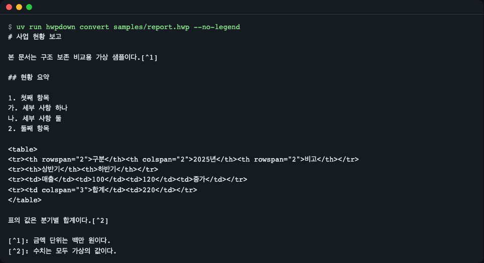
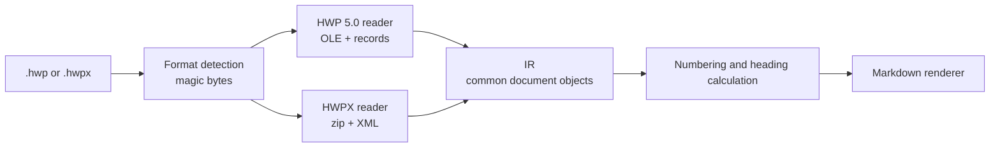
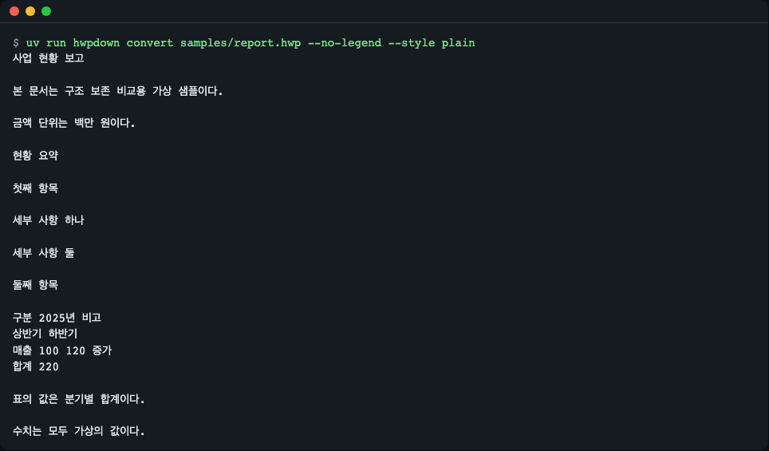
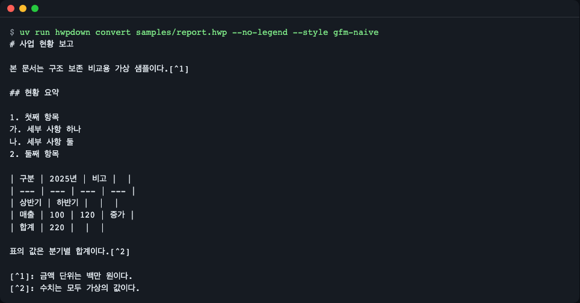
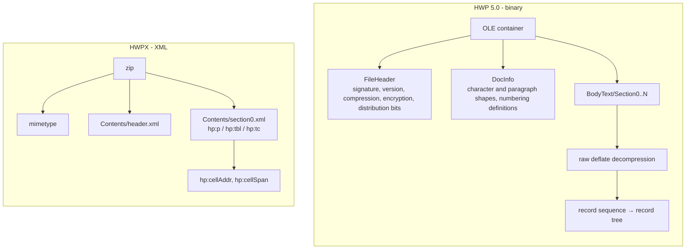
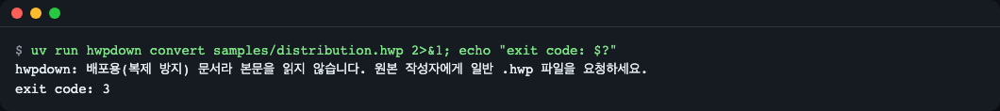
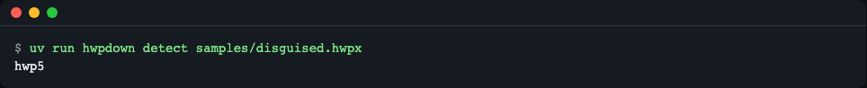
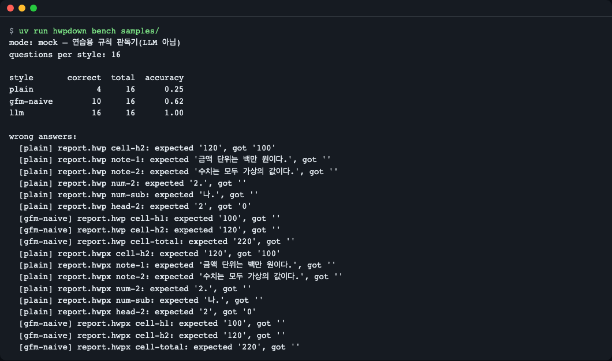

# hwpdown

[한국어](README.md) | **English**

hwpdown is a pure-Python library and CLI that reads HWP 5.0 and HWPX documents (`.hwp`, `.hwpx`) straight from the public file-format specs (no Node, no AGPL dependencies) and renders Markdown that keeps merged table cells, footnotes, automatic numbering and headings, so LLM/RAG pipelines get the structure the document really had. Its only runtime dependency is `olefile`. Install: `uv add git+https://github.com/LeeGyeongPil/hwpdown`. A built-in `hwpdown bench` command measures, on synthetic documents with known answers, how much structure matters (the default mode is a rule-based practice reader, not an LLM).



*Figure 1. Output of `hwpdown convert`. Headings, numbering, merged-cell tables and footnotes are all preserved.*

## Why it is needed

Generic text extractors flatten merged table cells, so a question like "What were sales in the second half of 2025?" can end up answered with the number from the neighboring cell. Footnotes get mixed into the body text, and paragraph-leading numbers such as `1.` and `가.` vanish because they are not stored as characters in the file. hwpdown restores all three. And you can measure for yourself whether this really helps with `hwpdown bench`.

## Installation

```bash
uv add git+https://github.com/LeeGyeongPil/hwpdown
# or pip: pip install git+https://github.com/LeeGyeongPil/hwpdown
```

- Python 3.10 or later; the only runtime dependency is `olefile`.
- If you do not have uv: `curl -LsSf https://astral.sh/uv/install.sh | sh` (on macOS, `brew install uv`).
- git is required (on a minimal Linux image, `apt-get install -y git curl`).
- To clone the repo and run it right away:

```bash
git clone https://github.com/LeeGyeongPil/hwpdown && cd hwpdown
uv sync
uv run hwpdown --version
```

```text
hwpdown 0.1.1
```

## Quick start

The `samples/` folder contains synthesized practice documents (with made-up content).

```python
import hwpdown
from hwpdown import RenderOptions

print(hwpdown.to_markdown("samples/report.hwp", options=RenderOptions(legend=False)))
```

```text
# 사업 현황 보고

본 문서는 구조 보존 비교용 가상 샘플이다.[^1]

## 현황 요약

1. 첫째 항목
가. 세부 사항 하나
나. 세부 사항 둘
2. 둘째 항목

<table>
<tr><th rowspan="2">구분</th><th colspan="2">2025년</th><th rowspan="2">비고</th></tr>
<tr><th>상반기</th><th>하반기</th></tr>
<tr><td>매출</td><td>100</td><td>120</td><td>증가</td></tr>
<tr><td colspan="3">합계</td><td>220</td></tr>
</table>

표의 값은 분기별 합계이다.[^2]

[^1]: 금액 단위는 백만 원이다.
[^2]: 수치는 모두 가상의 값이다.
```

(The sample document is in Korean: "Business status report", a numbered list, and a table with headers 구분 (category), 2025년 (2025), 상반기/하반기 (first/second half), 매출 (sales), 합계 (total), 비고 (notes). Footnote 1 says the amounts are in millions of won; footnote 2 says all figures are fictional.)

Doing the same from the command line looks like this. The "how to read" note at the top (a one-paragraph guide that tells the LLM what the `<table>` and `[^n]` notations mean) is removed with `--no-legend`.

```bash
uv run hwpdown convert samples/report.hwp --no-legend
```

`.hwpx` files are read the same way, and the results for `report.hwp` and `report.hwpx` are identical character for character (checked directly with `diff`).

## How to read the output

When you convert without `--no-legend`, a legend is attached as the first paragraph of the result. It is a note that keeps the LLM from misreading the notation, and it is shown here exactly as output.

```text
> 읽는 법: 이 글은 HWP/HWPX 문서를 변환한 것입니다. `<table>`은 병합 칸(rowspan/colspan)이 있는 표이고 `<th>`는 머리글 칸입니다. `[^n]`은 n번 각주이며 정의는 끝에 있습니다. `> [글상자]`는 글상자 안의 글입니다. 문단 앞의 `1.`·`가.` 같은 번호는 원본의 자동 번호입니다.
```

(In English: "How to read: this text was converted from an HWP/HWPX document. `<table>` is a table with merged cells (rowspan/colspan) and `<th>` is a header cell. `[^n]` is footnote n, and its definition is at the end. `> [글상자]` is text inside a text box. Numbers such as `1.` and `가.` before a paragraph are the original's automatic numbering.")

| Notation | Meaning |
|---|---|
| `# `, `## ` | Heading level (decided by style or font-size ratio) |
| `1.`, `가.` | Original automatic numbering (the file holds no characters, so it is counted and restored) |
| `<table>` + `rowspan`/`colspan` | A table with merged cells |
| `[^n]` | Footnote n (definition at the end of the document) |
| `> [글상자]` | Text inside a text box |

**Why HTML for tables**: GFM (GitHub-flavored Markdown) tables have no `rowspan`/`colspan`, so they cannot express merged cells. Forcing them into GFM pushes values into the wrong columns, as in Figure 4 below. Tables without merged cells are emitted as GFM tables (`table_mode="auto"`).

## Core concepts



*Figure 2. Both formats converge on the same intermediate representation (IR), and the renderer only looks at the IR.*

1. **Format detection**: decided by the first bytes, not the file extension, because a file named `.hwpx` may actually be an `.hwp`.
2. **Two readers, one IR**: HWP 5.0 is a sequence of compressed records inside an OLE container (a record = a 32-bit header giving kind, depth and size, plus content), and HWPX is XML inside a zip. Both are turned into a `Document` object (section → paragraphs, tables, text boxes, footnotes).
3. **Restoration step**: automatic numbers are not stored as characters in the file, so the document is scanned in order and numbering counters are computed (`1.`, `가.`, and so on). For documents without heading styles, a paragraph whose font size is at least 1.15 times the body text is treated as a heading.
4. **Rendering**: tables with merged cells become HTML tables with `rowspan`/`colspan`, and footnotes are renumbered across the whole document and emitted as `[^n]`.



*Figure 3. `--style plain`: headings, numbering and table structure are all gone, and footnotes are mixed into the middle of the body text.*



*Figure 4. `--style gfm-naive`: merged cells are simply filled into columns, so "하반기" (second half) is pushed into the "2025년" (2025) column and the values of the total row land in the wrong cells.*

Figures 3 and 4 are comparison baselines; for real use, rely on the default `llm` style.

## What the two formats look like



*Figure 8. Two containers for the same document. HWP 5.0 unpacks a compressed record sequence; HWPX unpacks XML.*

The body of HWP 5.0 is a series of **records**. Each record has a 32-bit (little-endian) header, split into these bits:

| Bits | 0-9 | 10-19 | 20-31 |
|---|---|---|---|
| Meaning | Tag (kind) | Level (depth) | Size |

If the size is `0xFFF`, the value did not fit, and the 4 bytes right after are the real size. The core of `src/hwpdown/hwp5/records.py`:

```python
(h,) = struct.unpack_from("<I", buf, pos)
tag, level, size = h & 0x3FF, (h >> 10) & 0x3FF, h >> 20
if size == 0xFFF:                      # Extended size: the next 4 bytes are the actual size
    (size,) = struct.unpack_from("<I", buf, pos + 4)
```

The level expresses the parent-child relationship, so the tree is rebuilt by taking, from a stack of preceding records, "the last record whose level is lower than mine" as the parent (`build_tree`). HWPX is already an XML tree, so reading just `hp:cellAddr` (row and column position) and `hp:cellSpan` (merge extent) under `hp:tc` gives the table structure.

### Three pitfalls when reading the spec directly

**1. The number characters are not in the file; you have to count them.** A paragraph only carries the information "use numbering definition N", and the characters `1.` or `가.` do not exist. So the document is scanned in order, a counter is incremented, and the number-shape code is converted to characters (`src/hwpdown/numbering.py`).

```python
def format_number(shape: int, n: int) -> str:
    if shape == 0:
        return str(n)                      # 1, 2, 3
    if shape == 8:
        return _from(_HANGUL, n)           # 가, 나, 다
    ...
```

**2. `LIST_HEADER` does not belong to table cells alone.** Paragraph groups inside text boxes and footnotes also start with the same `LIST_HEADER` record. That is why the rule "count only a `LIST_HEADER` that is a **direct child** of the table control as a cell" is needed (`src/hwpdown/hwp5/body.py`).

```python
def read_table(self, ctrl):
    """Only LIST_HEADERs that are direct children of this table control are cells."""
    ...
    for ch in ctrl.children:
        if ch.tag == LIST_HEADER:
            self.cell_count += 1           # A text box under a table is a grandchild, so it never gets here
```

Text boxes and footnotes are read by a separate function (`list_groups`), which treats the same record as a "paragraph group".

**3. Raw deflate without a declared size needs a real output cap.** The body stream does not record its uncompressed size. A small file can inflate to several GB, so the stream is inflated 1 MiB at a time, the actual bytes are counted, and decompression stops as soon as the cap is exceeded (`src/hwpdown/limits.py`).

```python
d = zlib.decompressobj(-15)            # -15: raw deflate without a zlib header
while pending and not d.eof:
    piece = d.decompress(pending, _CHUNK)   # Inflate at most 1 MiB at a time
    total += len(piece)
    if total > cap:
        raise _too_big(what, cap)
```

## Safeguards

There are default limits for the case of reading untrusted files.

- Actual decompressed bytes are counted (`Limits`: 64 MiB per stream, 256 MiB for the whole document) to reject compression bombs. Declared sizes are not trusted.
- There are caps on the number of records, nesting depth and number of table cells.
- Distribution-only (copy-protected) and encrypted documents are not decrypted; they are rejected with a message (exit code 3).

To build a compression bomb yourself and watch it get rejected (the files are created only in a temporary folder and nothing is left in the repo):

```bash
uv run python examples/make_bomb.py
```

```text
bomb.hwp: 371,712 bytes on disk, 80 MiB when inflated
  exit code: 4
  stderr: hwpdown: BodyText/Section0: decompressed size exceeds 67108864 bytes (possible compression bomb). Pass a larger Limits(max_stream_bytes=...) only if you trust the file.
bomb.hwpx: 81,909 bytes on disk, 80 MiB when inflated
  exit code: 4
  stderr: hwpdown: Contents/section0.xml: decompressed size exceeds 67108864 bytes (possible compression bomb). Pass a larger Limits(max_stream_bytes=...) only if you trust the file.
```



*Figure 5. A deliberately failing run. A distribution-only document is not read and the program ends with exit code 3.*



*Figure 6. `samples/disguised.hwpx` is named `.hwpx` only; it is really HWP 5.0, so it is detected as `hwp5`.*

## Command-line usage

| Command | What it does |
|---|---|
| `hwpdown detect FILE` | Prints the real format (`hwp5`/`hwpx`) |
| `hwpdown convert FILE [-o OUT] [--style llm\|plain\|gfm-naive] [--no-legend] [--json]` | Converts to Markdown (or to the IR with `--json`) |
| `hwpdown samples build DIR` | Generates fresh synthetic practice documents in DIR |
| `hwpdown bench DIR [--answerer mock\|llm] [--out FILE.jsonl]` | Compares question-answering accuracy per style |

Exit codes: 0 success / 2 unsupported or corrupt file, or a folder was passed / 3 distribution-only or encrypted document / 4 limit exceeded.

## Measuring the effect of conversion styles (bench)

`samples/questions.json` holds questions with known answers for each document (table cell values, footnotes, numbering, heading levels). `bench` converts the same documents in three styles, has them answer the questions, and counts the share answered correctly.

```bash
uv run hwpdown bench samples/
```

```text
mode: mock — 연습용 규칙 판독기(LLM 아님)
questions per style: 16

style       correct  total  accuracy
plain             4     16      0.25
gfm-naive        10     16      0.62
llm              16     16      1.00
```

(The first line reads "mode: mock — practice rule-based reader (not an LLM)". A list of wrong answers follows, for example `[gfm-naive] report.hwp cell-h1: expected '100', got ''`.)



*Figure 7. Accuracy comparison per style.*

**Note**: the default is a "practice mock mode". It is not an LLM but a reader that parses the converted text with an HTML table interpreter and rules. Because it really reads the same conversion output, the score is not a fixed fake number, but it differs from the accuracy of a real model. Real mode needs an OpenAI-compatible endpoint (for example a local Ollama).

```bash
cp .env.example .env   # Fill in HWPDOWN_LLM_BASE_URL, HWPDOWN_LLM_MODEL, HWPDOWN_LLM_API_KEY
uv run hwpdown bench samples/ --answerer llm
```

If the model name is empty, it stops with the message `HWPDOWN_LLM_MODEL is not set. ...` (only this path has been verified; a run with a real model attached has not been tried yet). Real mode can take a long time depending on model speed.

## API

All public names are imported from `hwpdown`.

| Name | What it does | Main arguments | Returns |
|---|---|---|---|
| `read(source, *, limits=None)` | Detects the format by magic bytes and reads | `source`: path or bytes | `Document` |
| `render(doc, options=None)` | IR to Markdown | `RenderOptions` | `str` |
| `to_markdown(source, *, options=None, limits=None)` | `read` + `render` | Same as above | `str` |
| `detect_format(source)` | Detects the real format | Path or bytes | `"hwp5"` or `"hwpx"` |
| `RenderOptions` | Render settings | `style` (`llm`/`plain`/`gfm-naive`), `legend`, `table_mode` (`auto`/`html`/`gfm`), `numbering`, `heading_ratio` (1.15), `section_marker` | Dataclass |
| `Limits` | Safety caps | `max_stream_bytes`, `max_total_bytes`, `max_records`, `max_depth`, `max_table_cells` | Dataclass |
| `Document` | Intermediate representation | `format`, `version`, `sections`, `para_shapes`, `numberings`, `warnings` | Dataclass |
| `HwpdownError` | Parent of all errors | — | Exception |
| `UnsupportedFormatError`, `CorruptDocumentError` | Unsupported or corrupt file | — | Exception (exit code 2) |
| `DistributionDocumentError` | Distribution-only or encrypted document | — | Exception (exit code 3) |
| `LimitExceededError` | Safety cap exceeded | — | Exception (exit code 4) |
| `CREDIT` | Spec attribution text | — | `str` |

## Usage examples

### 1. Read one document and inspect the IR

```python
import hwpdown

doc = hwpdown.read("samples/report.hwp")
print(doc.format, len(doc.sections), len(doc.sections[0].blocks))
```

```text
hwp5 1 9
```

### 2. Changing options and handling errors

```python
import hwpdown
from hwpdown import RenderOptions, DistributionDocumentError

md = hwpdown.to_markdown("samples/report.hwpx", options=RenderOptions(legend=False, numbering=False))
print(md.splitlines()[4:9])
try:
    hwpdown.read("samples/distribution.hwp")
except DistributionDocumentError as e:
    print("skip:", type(e).__name__, e.exit_code)
```

```text
['## 현황 요약', '', '첫째 항목', '', '세부 사항 하나']
skip: DistributionDocumentError 3
```

Turning off automatic-number restoration with `numbering=False` removes the `1.` and `가.` markers.

### 3. The example file in the repo

```bash
uv run python examples/basic.py samples/report.hwp
```

`examples/basic.py` prints the conversion result, including the how-to-read note.

### 4. Building your own practice documents

```bash
uv run hwpdown samples build /tmp/my-samples
```

```text
/tmp/my-samples/report.hwp
/tmp/my-samples/report.hwpx
/tmp/my-samples/budget.hwp
/tmp/my-samples/disguised.hwpx
/tmp/my-samples/distribution.hwp
/tmp/my-samples/questions.json
```

(The folder part of the output depends on where you run it. The file list is the actual run result.)

## Code tour

| Location | What to look at |
|---|---|
| `src/hwpdown/detect.py` | Detects the format from the first 8 bytes (OLE) or the zip `mimetype` entry |
| `src/hwpdown/hwp5/records.py` | Unpacks the 32-bit record header (10-bit tag, 10-bit depth, 12-bit size) and rebuilds the tree |
| `src/hwpdown/limits.py` | Inflates 1 MiB at a time, counts actual bytes, and aborts immediately past the cap |
| `src/hwpdown/numbering.py`, `headings.py` | Number counter calculation; heading inference from font-size ratio |
| `src/hwpdown/render/` | Rendering of tables (HTML/GFM), footnotes and text boxes |

## When to use it

- It fits when you want to read HWP 5.0/HWPX with Python alone and feed Markdown that preserves merged-cell tables, footnotes and automatic numbering into an LLM/RAG pipeline. It works without Node or AGPL dependencies.
- This library is read-only; writing (creating) documents, image extraction, OCR, MCP and HWP 3.0 are out of scope. If you need those, also look at [kordoc](https://github.com/chrisryugj/kordoc) or [python-hwpx](https://github.com/airmang/python-hwpx).

## Limitations and roadmap

Current limitations: it has only been verified against synthetic documents and answers made by the author (accuracy on real public documents is unverified). Images, equations and OCR are not handled, and distribution-only and encrypted documents are rejected.

| Stage | Plan | Status |
|---|---|---|
| M1-M2 | HWP5/HWPX reading, numbering/heading/footnote restoration, safety caps, bench | Included in 0.1.0 |
| M3 | Comparison with external converter adapters, LangChain and LlamaIndex loaders, user-defined character (PUA) mapping | Planned |
| M4 | Image extraction and vision captions, MCP server | Planned |

The plan is not a promise, and priorities may change.

## Troubleshooting

| Symptom | Cause | Fix |
|---|---|---|
| `UnsupportedFormatError: Unknown file signature` | An unsupported format such as HWP 3.0, or a different kind of file | Check with `hwpdown detect FILE`, and re-save from Hangul as `.hwp` (5.0) or `.hwpx` |
| Exit code 3, "배포용(복제 방지) 문서" (distribution-only, copy-protected document) | A copy-protected or encrypted document | Ask the original author for a regular `.hwp` file (it is not decrypted) |
| Exit code 4, `LimitExceededError` | A compression bomb or a very large document | If you trust the file, pass a larger `Limits(max_total_bytes=...)` |
| `bench --answerer llm` stops with `HWPDOWN_LLM_MODEL is not set` | Model name not set | Enter `HWPDOWN_LLM_MODEL=...` in the `.env` of the current folder (copy `.env.example`). Environment variables that are already set take precedence |
| `hwpdown: ... is a directory`, exit code 2 | A folder was passed instead of a file | Specify the path of an `.hwp`/`.hwpx` file |
| A table appears as `<table>` and looks broken in a Markdown viewer | Tables with merged cells are emitted as HTML (intended) | Force it with `RenderOptions(table_mode="gfm")`, but the merge information is lost |

## Versions and compatibility

- Follows Semantic Versioning (SemVer). During 0.x the API may change in minor versions, and any change is recorded in [CHANGELOG.md](CHANGELOG.md) (Korean).
- It has only been verified against synthetic documents and their answers made by the author. Accuracy on real public documents is not guaranteed, and known limitations are accepted as issues.

## Development and contributing

```bash
uv sync
uv run pytest -q
```

```text
56 passed
```

## Learn more

- Hancom HWP 5.0 document file format (public document): https://cdn.hancom.com/link/docs/한글문서파일형식_5.0_revision1.3.pdf (checked 2026-11-09)
- Hancom public document download and terms of use: https://store.hancom.com/etc/hwpDownload.do (checked 2026-11-09)
- Distribution document format: https://cdn.hancom.com/link/docs/한글문서파일형식_배포용문서_revision1.2.pdf (checked 2026-11-09)
- KS X 6101 (OWPML) standard information: https://www.kssn.net/search/stddetail.do?itemNo=K001010119985 (checked 2026-11-09)
- Other HWP tools: https://github.com/chrisryugj/kordoc , https://github.com/airmang/python-hwpx (checked 2026-11-09)
- A vendor article arguing that losing merged cells degrades RAG quality (a vendor article, so it may be biased): https://blog.hancom.com/en/?p=1184 (checked 2026-11-09)

## Glossary

| Term | Meaning |
|---|---|
| HWP 5.0 | Hangul's binary document format. Compressed records inside an OLE container |
| HWPX | Hangul's XML document format (OWPML, KS X 6101). Packed as a zip |
| OLE/CFB | A Microsoft container format that holds a small file system inside a file |
| IR | Intermediate representation. Gathers the two formats into the same objects |
| RAG | A method of retrieving documents and giving them to an LLM as evidence |
| Merged cell | A table cell that spans several rows or columns (`rowspan`/`colspan`) |

## License

MIT. [LICENSE](LICENSE). Third-party notices are in [NOTICE](NOTICE).

본 제품은 한글과컴퓨터의 한/글 문서 파일(.hwp) 공개 문서를 참고하여 개발하였습니다.
(This product was developed with reference to the public file-format documents of Hancom's Hangul (.hwp).)
