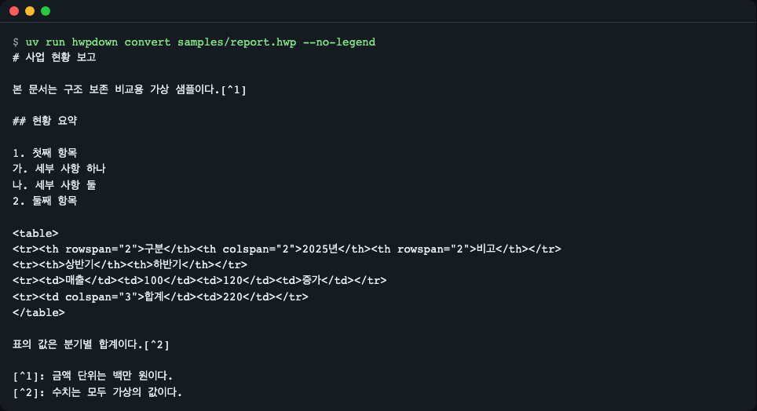
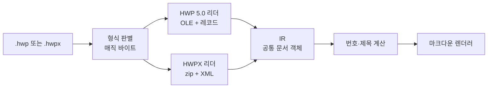
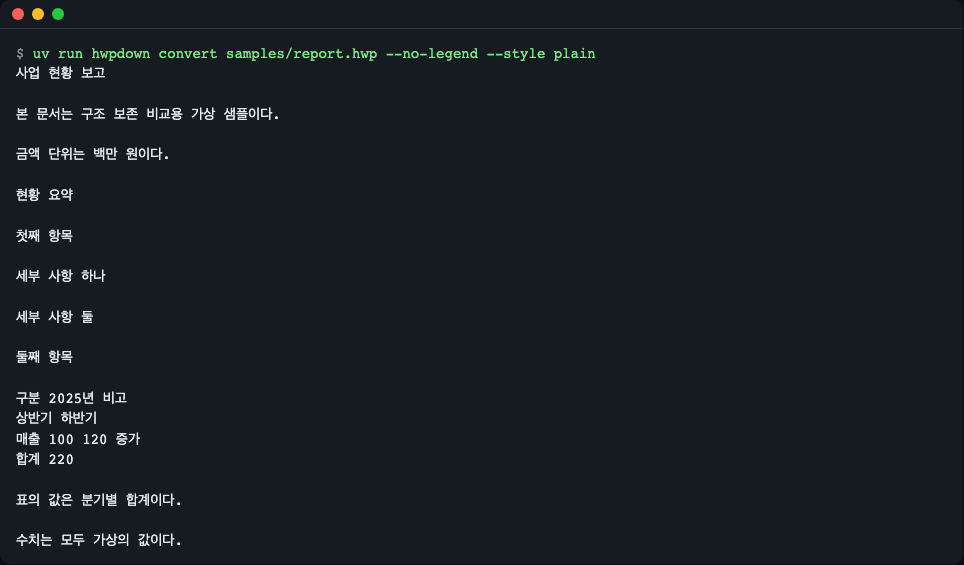
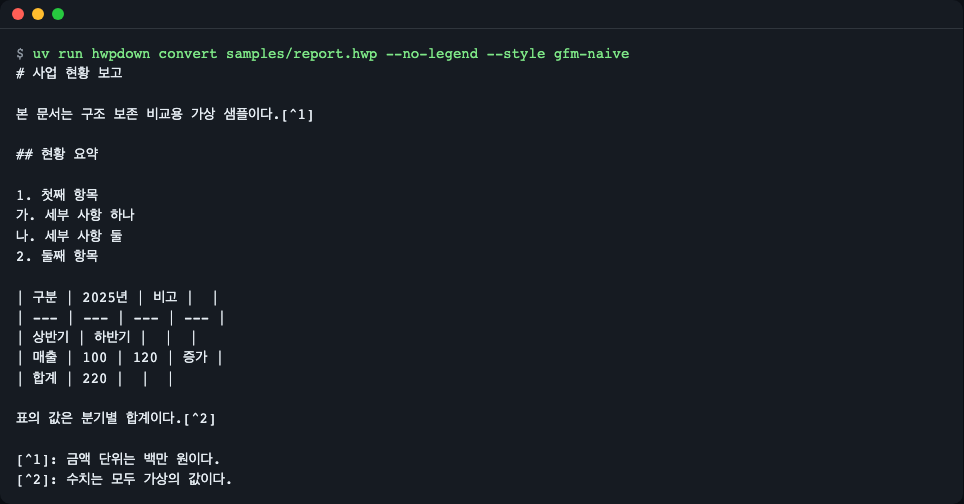
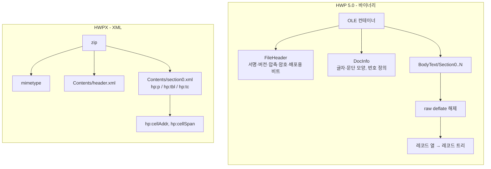
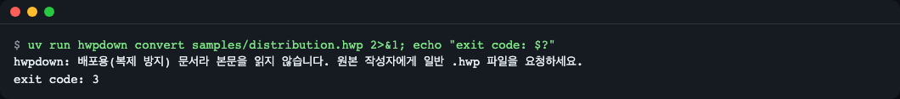
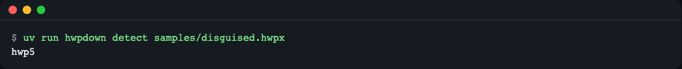
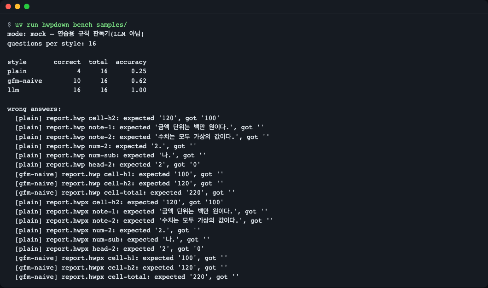

# hwpdown

> **English summary** — hwpdown is a pure-Python library and CLI that reads HWP 5.0 and HWPX documents straight from the public file-format specs and renders Markdown that keeps merged table cells, footnotes, automatic numbering and headings, so LLM/RAG pipelines get the structure the document really had. Its only runtime dependency is `olefile`. Install: `uv add git+https://github.com/LeeGyeongPil/hwpdown`. A built-in `hwpdown bench` command measures, on synthetic documents with known answers, how much structure matters (the default mode is a rule-based practice reader, not an LLM).

한/글 문서(`.hwp`, `.hwpx`)를 **표·각주·번호가 흐트러지지 않은 마크다운**으로 바꿔 주는 파이썬 라이브러리 겸 명령줄 도구입니다. Node나 AGPL 의존성 없이, 공개된 파일 규격을 직접 읽습니다.



*그림 1. `hwpdown convert`의 결과. 제목, 번호, 병합 칸 표, 각주가 모두 남아 있습니다.*

## 왜 필요한가

일반 텍스트 추출기는 병합된 표 칸을 풀어 버려, "2025년 하반기 매출은?" 같은 질문에 옆 칸의 숫자를 답하게 만들 수 있습니다. 각주는 본문 속에 섞이고, 문단 앞의 `1.`·`가.` 번호는 파일에 글자로 저장되어 있지 않아 사라집니다. hwpdown은 이 세 가지를 복원합니다. 그리고 "정말 도움이 되는가"를 `hwpdown bench`로 직접 재 볼 수 있습니다.

## 설치

```bash
uv add git+https://github.com/LeeGyeongPil/hwpdown
# 또는 pip: pip install git+https://github.com/LeeGyeongPil/hwpdown
```

- Python 3.10 이상, 런타임 의존성은 `olefile` 하나입니다.
- uv가 없다면: `curl -LsSf https://astral.sh/uv/install.sh | sh` (macOS는 `brew install uv`).
- git이 필요합니다(최소 리눅스 이미지라면 `apt-get install -y git curl`).
- 레포를 받아 바로 돌려 보려면:

```bash
git clone https://github.com/LeeGyeongPil/hwpdown && cd hwpdown
uv sync
uv run hwpdown --version
```

```text
hwpdown 0.1.0
```

## 빠르게 시작하기

`samples/` 폴더에 합성한 연습용 문서(가상의 내용)가 들어 있습니다.

```python
import hwpdown
from hwpdown import RenderOptions

print(hwpdown.to_markdown("samples/report.hwp", options=RenderOptions(legend=False)))
```

```text
# 사업 현황 보고

본 문서는 구조 보존 비교용 가상 샘플이다.[^1]

## 현황 요약

1. 첫째 항목
가. 세부 사항 하나
나. 세부 사항 둘
2. 둘째 항목

<table>
<tr><th rowspan="2">구분</th><th colspan="2">2025년</th><th rowspan="2">비고</th></tr>
<tr><th>상반기</th><th>하반기</th></tr>
<tr><td>매출</td><td>100</td><td>120</td><td>증가</td></tr>
<tr><td colspan="3">합계</td><td>220</td></tr>
</table>

표의 값은 분기별 합계이다.[^2]

[^1]: 금액 단위는 백만 원이다.
[^2]: 수치는 모두 가상의 값이다.
```

같은 일을 명령줄로 하면 이렇습니다. 맨 앞에 붙는 "읽는 법" 안내(LLM에게 `<table>`·`[^n]` 표기법을 알려 주는 한 단락)는 `--no-legend`로 뺍니다.

```bash
uv run hwpdown convert samples/report.hwp --no-legend
```

`.hwpx` 파일도 같은 방법으로 읽으며, `report.hwp`와 `report.hwpx`의 결과는 글자 단위로 같습니다(직접 `diff`로 확인했습니다).

## 출력 읽는 법

`--no-legend` 없이 변환하면 결과의 첫 단락에 범례가 붙습니다. LLM이 표기법을 오해하지 않도록 알려 주는 안내문이며, 실제 출력 그대로입니다.

```text
> 읽는 법: 이 글은 HWP/HWPX 문서를 변환한 것입니다. `<table>`은 병합 칸(rowspan/colspan)이 있는 표이고 `<th>`는 머리글 칸입니다. `[^n]`은 n번 각주이며 정의는 끝에 있습니다. `> [글상자]`는 글상자 안의 글입니다. 문단 앞의 `1.`·`가.` 같은 번호는 원본의 자동 번호입니다.
```

| 표기 | 뜻 |
|---|---|
| `# `, `## ` | 제목 단계(스타일 또는 글자 크기 비율로 판단) |
| `1.`, `가.` | 원본의 자동 번호(파일에 글자가 없어 세어서 복원) |
| `<table>` + `rowspan`/`colspan` | 병합 칸이 있는 표 |
| `[^n]` | n번 각주(정의는 문서 끝) |
| `> [글상자]` | 글상자 안의 글 |

**표에 HTML을 쓰는 이유**: GFM(깃허브식 마크다운) 표에는 `rowspan`/`colspan`이 없어 병합 칸을 표현할 수 없습니다. 억지로 GFM에 넣으면 아래 그림 4처럼 값이 엉뚱한 열로 밀립니다. 병합 칸이 없는 표는 GFM 표로 냅니다(`table_mode="auto"`).

## 핵심 개념



*그림 2. 두 형식이 같은 중간 표현(IR)으로 모이고, 렌더러는 IR만 봅니다.*

1. **형식 판별**: 파일 확장자가 아니라 첫 바이트로 판단합니다. `.hwpx`라는 이름이어도 실제로는 `.hwp`일 수 있기 때문입니다.
2. **두 리더, 하나의 IR**: HWP 5.0은 OLE 컨테이너 안의 압축된 레코드 열(레코드 = 종류·깊이·크기가 적힌 32비트 머리 + 내용)이고, HWPX는 zip 안의 XML입니다. 둘 다 `Document`(구역 → 문단·표·글상자·각주) 객체로 바꿉니다.
3. **복원 단계**: 자동 번호는 파일에 글자가 없으므로 문서를 순서대로 훑으며 번호 카운터를 계산합니다(`1.`, `가.` 등). 제목 스타일이 없는 문서는 본문 대비 글자 크기가 1.15배 이상인 문단을 제목으로 봅니다.
4. **렌더링**: 병합 칸이 있는 표는 `rowspan`/`colspan`이 있는 HTML 표로, 각주는 문서 전체에서 다시 번호를 매겨 `[^n]`으로 냅니다.



*그림 3. `--style plain`: 제목·번호·표 구조가 모두 사라지고 각주가 본문 중간에 섞입니다.*



*그림 4. `--style gfm-naive`: 병합 칸을 그대로 열에 채워 "하반기"가 "2025년" 열로 밀리고 합계 행의 값이 엉뚱한 칸에 들어갑니다.*

그림 3·4는 비교용 기준선이며, 실제 용도로는 기본값 `llm` 스타일을 씁니다.

## 두 형식은 어떻게 생겼나



*그림 8. 같은 문서를 담는 두 가지 그릇. HWP 5.0은 압축된 레코드 열을, HWPX는 XML을 풉니다.*

HWP 5.0의 본문은 **레코드**의 연속입니다. 레코드마다 32비트(리틀 엔디언) 머리가 있고, 아래 비트로 나뉩니다.

| 비트 | 0~9 | 10~19 | 20~31 |
|---|---|---|---|
| 의미 | 태그(종류) | 레벨(깊이) | 크기 |

크기가 `0xFFF`이면 값이 모자란 것이므로 바로 뒤 4바이트가 진짜 크기입니다. `src/hwpdown/hwp5/records.py`의 핵심 부분입니다.

```python
(h,) = struct.unpack_from("<I", buf, pos)
tag, level, size = h & 0x3FF, (h >> 10) & 0x3FF, h >> 20
if size == 0xFFF:                      # 확장 크기: 다음 4바이트가 실제 크기
    (size,) = struct.unpack_from("<I", buf, pos + 4)
```

레벨은 부모-자식 관계를 뜻하므로, 직전 레코드들의 스택에서 "나보다 레벨이 낮은 마지막 레코드"를 부모로 삼아 트리를 다시 만듭니다(`build_tree`). HWPX는 이미 XML 트리이므로 `hp:tc` 아래 `hp:cellAddr`(행·열 위치)와 `hp:cellSpan`(병합 폭)만 읽으면 표 구조가 나옵니다.

### 규격을 직접 읽을 때 걸리는 세 곳

**1. 번호 글자는 파일에 없습니다 — 세어야 합니다.** 문단에는 "번호 정의 N번을 쓴다"는 정보만 있고 `1.`이나 `가.`라는 글자는 없습니다. 그래서 문서를 순서대로 훑으며 카운터를 올리고, 번호 모양 코드를 글자로 바꿉니다(`src/hwpdown/numbering.py`).

```python
def format_number(shape: int, n: int) -> str:
    if shape == 0:
        return str(n)                      # 1, 2, 3
    if shape == 8:
        return _from(_HANGUL, n)           # 가, 나, 다
    ...
```

**2. `LIST_HEADER`는 표 칸만의 것이 아닙니다.** 글상자·각주 안의 문단 묶음도 같은 `LIST_HEADER` 레코드로 시작합니다. 그래서 "표 컨트롤의 **직접 자식**인 `LIST_HEADER`만 칸으로 센다"는 규칙이 필요합니다(`src/hwpdown/hwp5/body.py`).

```python
def read_table(self, ctrl):
    """Only LIST_HEADERs that are direct children of this table control are cells."""
    ...
    for ch in ctrl.children:
        if ch.tag == LIST_HEADER:
            self.cell_count += 1           # 표 밑의 글상자 것은 자식의 자식이라 여기 오지 않음
```

글상자·각주는 별도 함수(`list_groups`)가 같은 레코드를 "문단 묶음"으로 읽습니다.

**3. 선언된 크기가 없는 raw deflate에는 실제 출력 상한이 필요합니다.** 본문 스트림은 압축 전 크기가 적혀 있지 않습니다. 작은 파일이 수 GB로 풀릴 수 있으므로 1MiB씩 풀면서 실제 바이트를 세어 상한을 넘는 즉시 멈춥니다(`src/hwpdown/limits.py`).

```python
d = zlib.decompressobj(-15)            # -15: zlib 머리 없는 raw deflate
while pending and not d.eof:
    piece = d.decompress(pending, _CHUNK)   # 한 번에 최대 1MiB만 푼다
    total += len(piece)
    if total > cap:
        raise _too_big(what, cap)
```

## 안전 장치

신뢰할 수 없는 파일을 읽는 경우를 위해 기본 상한이 있습니다.

- 압축을 푼 실제 바이트 수를 세어(`Limits`: 스트림당 64MiB, 문서 전체 256MiB) 압축 폭탄을 거부합니다. 선언된 크기는 믿지 않습니다.
- 레코드 수, 중첩 깊이, 표 칸 수 상한이 있습니다.
- 배포용(복제 방지)·암호 문서는 해독하지 않고 안내와 함께 거부합니다(종료 코드 3).

압축 폭탄을 직접 만들어 거부되는 모습을 보려면(파일은 임시 폴더에만 만들어지고 레포에는 남지 않습니다):

```bash
uv run python examples/make_bomb.py
```

```text
bomb.hwp: 371,712 bytes on disk, 80 MiB when inflated
  exit code: 4
  stderr: hwpdown: BodyText/Section0: decompressed size exceeds 67108864 bytes (possible compression bomb). Pass a larger Limits(max_stream_bytes=...) only if you trust the file.
bomb.hwpx: 81,909 bytes on disk, 80 MiB when inflated
  exit code: 4
  stderr: hwpdown: Contents/section0.xml: decompressed size exceeds 67108864 bytes (possible compression bomb). Pass a larger Limits(max_stream_bytes=...) only if you trust the file.
```



*그림 5. 의도적으로 실패시킨 화면. 배포용 문서는 읽지 않고 종료 코드 3으로 끝납니다.*



*그림 6. `samples/disguised.hwpx`는 이름만 `.hwpx`이고 실제로는 HWP 5.0이라 `hwp5`로 판별됩니다.*

## 명령줄 사용법

| 명령 | 하는 일 |
|---|---|
| `hwpdown detect FILE` | 실제 형식(`hwp5`/`hwpx`)을 출력 |
| `hwpdown convert FILE [-o OUT] [--style llm\|plain\|gfm-naive] [--no-legend] [--json]` | 마크다운(또는 `--json`으로 IR)으로 변환 |
| `hwpdown samples build DIR` | 합성 연습 문서를 DIR에 새로 생성 |
| `hwpdown bench DIR [--answerer mock\|llm] [--out FILE.jsonl]` | 스타일별 질문 정답률 비교 |

종료 코드: 0 성공 / 2 지원하지 않거나 깨진 파일·폴더를 넘긴 경우 / 3 배포용·암호 문서 / 4 상한 초과.

## 변환 스타일의 효과 재 보기 (bench)

`samples/questions.json`에는 각 문서의 정답이 있는 질문(표 칸 값, 각주, 번호, 제목 단계)이 들어 있습니다. `bench`는 같은 문서를 세 스타일로 변환한 뒤 질문에 답하게 하고 맞힌 비율을 셉니다.

```bash
uv run hwpdown bench samples/
```

```text
mode: mock — 연습용 규칙 판독기(LLM 아님)
questions per style: 16

style       correct  total  accuracy
plain             4     16      0.25
gfm-naive        10     16      0.62
llm              16     16      1.00
```

(이어서 틀린 답 목록이 출력됩니다. 예: `[gfm-naive] report.hwp cell-h1: expected '100', got ''`.)



*그림 7. 스타일별 정답률 비교.*

**주의**: 기본값은 "연습용 목(mock) 모드"입니다. LLM이 아니라, 변환된 텍스트를 HTML 표 해석기와 규칙으로 읽는 판독기입니다. 같은 변환 결과를 실제로 읽어 계산하므로 고정된 가짜 점수는 아니지만, 실제 모델의 정답률과는 다릅니다. 실제 모드는 OpenAI 호환 엔드포인트(예: 로컬 Ollama)가 필요합니다.

```bash
cp .env.example .env   # HWPDOWN_LLM_BASE_URL, HWPDOWN_LLM_MODEL, HWPDOWN_LLM_API_KEY 를 채운다
uv run hwpdown bench samples/ --answerer llm
```

모델 이름이 비어 있으면 `HWPDOWN_LLM_MODEL is not set. ...` 안내와 함께 멈춥니다(이 경로까지만 확인했고, 실제 모델을 붙인 실행은 아직 해 보지 않았습니다). 실제 모드는 모델 속도에 따라 오래 걸릴 수 있습니다.

## API

공개 이름은 모두 `hwpdown`에서 가져옵니다.

| 이름 | 하는 일 | 주요 인자 | 반환 |
|---|---|---|---|
| `read(source, *, limits=None)` | 매직 바이트로 형식을 판별해 읽기 | `source`: 경로 또는 bytes | `Document` |
| `render(doc, options=None)` | IR을 마크다운으로 | `RenderOptions` | `str` |
| `to_markdown(source, *, options=None, limits=None)` | `read` + `render` | 위와 같음 | `str` |
| `detect_format(source)` | 실제 형식 판별 | 경로 또는 bytes | `"hwp5"` 또는 `"hwpx"` |
| `RenderOptions` | 렌더 설정 | `style`(`llm`/`plain`/`gfm-naive`), `legend`, `table_mode`(`auto`/`html`/`gfm`), `numbering`, `heading_ratio`(1.15), `section_marker` | 데이터클래스 |
| `Limits` | 안전 상한 | `max_stream_bytes`, `max_total_bytes`, `max_records`, `max_depth`, `max_table_cells` | 데이터클래스 |
| `Document` | 중간 표현 | `format`, `version`, `sections`, `para_shapes`, `numberings`, `warnings` | 데이터클래스 |
| `HwpdownError` | 모든 오류의 부모 | — | 예외 |
| `UnsupportedFormatError`, `CorruptDocumentError` | 지원하지 않거나 깨진 파일 | — | 예외(종료 코드 2) |
| `DistributionDocumentError` | 배포용·암호 문서 | — | 예외(종료 코드 3) |
| `LimitExceededError` | 안전 상한 초과 | — | 예외(종료 코드 4) |
| `CREDIT` | 규격 출처 문구 | — | `str` |

## 사용 예

### 1. 한 문서를 읽고 IR 살펴보기

```python
import hwpdown

doc = hwpdown.read("samples/report.hwp")
print(doc.format, len(doc.sections), len(doc.sections[0].blocks))
```

```text
hwp5 1 9
```

### 2. 옵션 바꾸기와 오류 처리

```python
import hwpdown
from hwpdown import RenderOptions, DistributionDocumentError

md = hwpdown.to_markdown("samples/report.hwpx", options=RenderOptions(legend=False, numbering=False))
print(md.splitlines()[4:9])
try:
    hwpdown.read("samples/distribution.hwp")
except DistributionDocumentError as e:
    print("skip:", type(e).__name__, e.exit_code)
```

```text
['## 현황 요약', '', '첫째 항목', '', '세부 사항 하나']
skip: DistributionDocumentError 3
```

`numbering=False`로 자동 번호 복원을 끄면 `1.`·`가.`이 사라집니다.

### 3. 레포의 예제 파일

```bash
uv run python examples/basic.py samples/report.hwp
```

`examples/basic.py`는 읽는 법 안내를 포함해 변환 결과를 출력합니다.

### 4. 자기 연습 문서 만들기

```bash
uv run hwpdown samples build /tmp/my-samples
```

```text
/tmp/my-samples/report.hwp
/tmp/my-samples/report.hwpx
/tmp/my-samples/budget.hwp
/tmp/my-samples/disguised.hwpx
/tmp/my-samples/distribution.hwp
/tmp/my-samples/questions.json
```

(출력의 폴더 부분은 실행 위치에 따라 달라집니다. 파일 목록은 실제 실행 결과입니다.)

## 코드 둘러보기

| 위치 | 볼 것 |
|---|---|
| `src/hwpdown/detect.py` | 첫 8바이트(OLE) 또는 zip의 `mimetype` 항목으로 형식을 판별 |
| `src/hwpdown/hwp5/records.py` | 32비트 레코드 머리(태그 10비트·깊이 10비트·크기 12비트)를 풀어 트리로 재구성 |
| `src/hwpdown/limits.py` | 1MiB씩 풀며 실제 바이트를 세어 상한을 넘으면 즉시 중단 |
| `src/hwpdown/numbering.py`, `headings.py` | 번호 카운터 계산, 글자 크기 비율로 제목 추정 |
| `src/hwpdown/render/` | 표(HTML/GFM)·각주·글상자 렌더링 |

## 다른 변환기와 비교

2026-11-09에 각 레포의 문서와 직접 실행(프로브)으로 확인한 내용입니다. 출처는 아래 "더 알아보기" 절에 있습니다.

| | hwpdown | kordoc | python-hwpx |
|---|---|---|---|
| 언어 | 순수 파이썬 | TypeScript(Node 필요) | 순수 파이썬 |
| 병합 칸 | HTML 표로 보존 | HTML 표로 보존 | HTML 표로 보존 |
| 자동 번호 복원 | 지원 | 지원 | 미지원 |
| 각주 | 문서 전체 재번호 | 인라인 괄호 | 각주가 둘 이상일 때 번호가 겹쳐 내용 유실 확인 |
| 쓰기(생성) | 없음(읽기 전용) | 확인하지 않음 | 지원 |
| 라이선스 | MIT | MIT | Apache-2.0 |

이 라이브러리는 읽기 전용이며 그림 추출·OCR·MCP·HWP 3.0은 범위 밖입니다. 쓰기나 더 넓은 형식이 필요하면 위 도구가 더 맞습니다.

## 한계·로드맵

현재 한계: 직접 만든 합성 문서와 정답으로만 검증했습니다(실제 공공 문서 정확도는 미검증). 그림·수식·OCR은 다루지 않고, 배포용·암호 문서는 거부합니다.

| 단계 | 계획 | 상태 |
|---|---|---|
| M1~M2 | HWP5·HWPX 읽기, 번호·제목·각주 복원, 안전 상한, bench | 0.1.0에 포함 |
| M3 | 외부 변환기 어댑터 비교, LangChain·LlamaIndex 로더, 사용자 정의 문자(PUA) 매핑 | 계획 |
| M4 | 그림 추출·비전 캡션, MCP 서버 | 계획 |

계획은 약속이 아니며 우선순위는 바뀔 수 있습니다.

## 자주 겪는 문제

| 증상 | 원인 | 해결 |
|---|---|---|
| `UnsupportedFormatError: Unknown file signature` | HWP 3.0 등 지원하지 않는 형식이거나 다른 파일 | `hwpdown detect FILE`로 확인, 한/글에서 `.hwp`(5.0) 또는 `.hwpx`로 다시 저장 |
| 종료 코드 3, "배포용(복제 방지) 문서" | 복제 방지·암호 문서 | 원본 작성자에게 일반 `.hwp` 파일 요청(해독하지 않습니다) |
| 종료 코드 4, `LimitExceededError` | 압축 폭탄이거나 매우 큰 문서 | 믿을 수 있는 파일이면 `Limits(max_total_bytes=...)`를 키워 전달 |
| `bench --answerer llm`이 `HWPDOWN_LLM_MODEL is not set`으로 멈춤 | 모델 이름 미설정 | 현재 폴더의 `.env`(`.env.example` 복사)에 `HWPDOWN_LLM_MODEL=...` 입력. 이미 설정된 환경 변수가 우선 |
| `hwpdown: ... is a directory`, 종료 코드 2 | 파일 대신 폴더를 넘김 | `.hwp`/`.hwpx` 파일 경로를 지정 |
| 표가 `<table>`로 나와 마크다운 뷰어에서 깨져 보임 | 병합 칸이 있는 표는 HTML로 냄(의도) | `RenderOptions(table_mode="gfm")`로 강제하되 병합 정보는 유실됨 |

## 버전·호환성

- 유의적 버전(SemVer)을 따릅니다. 0.x 동안은 마이너 버전에서 API가 바뀔 수 있고, 바뀌면 [CHANGELOG.md](CHANGELOG.md)에 적습니다.
- 직접 만든 합성 문서와 그 정답으로만 검증했습니다. 실제 공공 문서에서의 정확도는 보장하지 않으며, 알려진 한계는 이슈로 받습니다.

## 개발·기여

```bash
uv sync
uv run pytest -q
```

```text
56 passed
```

## 더 알아보기

- 한컴 HWP 5.0 문서 파일 형식(공개 문서): https://cdn.hancom.com/link/docs/한글문서파일형식_5.0_revision1.3.pdf (확인 2026-11-09)
- 한컴 공개 문서 다운로드·이용 조건: https://store.hancom.com/etc/hwpDownload.do (확인 2026-11-09)
- 배포용 문서 형식: https://cdn.hancom.com/link/docs/한글문서파일형식_배포용문서_revision1.2.pdf (확인 2026-11-09)
- KS X 6101(OWPML) 표준 정보: https://www.kssn.net/search/stddetail.do?itemNo=K001010119985 (확인 2026-11-09)
- 비교한 도구: https://github.com/chrisryugj/kordoc , https://github.com/airmang/python-hwpx (확인 2026-11-09)
- 병합 칸 손실이 RAG 품질을 떨어뜨린다는 제작사 글(제작사 글이라 편향 가능): https://blog.hancom.com/en/?p=1184 (확인 2026-11-09)

## 용어 사전

| 용어 | 뜻 |
|---|---|
| HWP 5.0 | 한/글의 바이너리 문서 형식. OLE 컨테이너 안에 압축된 레코드가 들어 있음 |
| HWPX | 한/글의 XML 문서 형식(OWPML, KS X 6101). zip으로 묶여 있음 |
| OLE/CFB | 파일 안에 작은 파일 시스템을 담는 마이크로소프트 컨테이너 형식 |
| IR | 중간 표현. 두 형식을 같은 객체로 모아 둔 것 |
| RAG | 문서를 검색해 LLM에게 근거로 주는 방식 |
| 병합 칸 | 여러 행·열에 걸친 표 칸(`rowspan`/`colspan`) |

## 라이선스

MIT. [LICENSE](LICENSE). 서드파티 고지는 [NOTICE](NOTICE)에 있습니다.

본 제품은 한글과컴퓨터의 한/글 문서 파일(.hwp) 공개 문서를 참고하여 개발하였습니다.
(This product was developed with reference to the public file-format documents of Hancom's Hangul (.hwp).)
